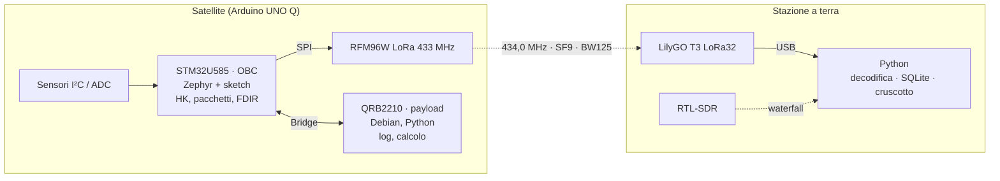

# Architettura

## Principio guida

Le funzioni vitali non dipendono da quelle opzionali: la catena
sensori → pacchetto → radio vive tutta sull'MCU. Se Linux (payload) si blocca,
il satellite continua a trasmettere e lo segnala nella telemetria.

## Scelte di progetto

| Decisione | Scelta | Motivo |
|---|---|---|
| Formato pacchetti | Space Packet CCSDS 133.0-B-2 con intestazione secondaria in stile PUS | Formato dei satelliti veri |
| Controllo d'errore | CRC-16 CCITT (poly 0x1021, init 0xFFFF) in coda | Lo stesso del PUS, semplice in C e Python |
| Radio | LoRa 434,0 MHz, BW 125 kHz, SF9, CR 4/7, 2 dBm | Robusta, economica, visibile con RTL-SDR |
| Banda | SRD 433,05–434,79 MHz (10 mW e.r.p., duty cycle ≤ 10%) | Nessuna licenza necessaria |
| Software di terra | Python: pyserial, SQLite, Streamlit | Un solo linguaggio, testabile con pytest |
| Repository | Monorepo, un tag per tappa | Evoluzione leggibile, baseline per tappa |
